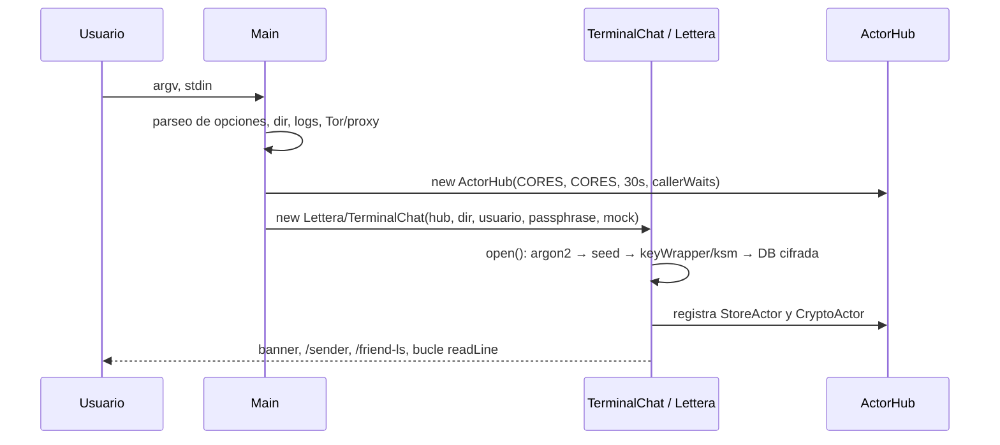

# Lettera — Arquitectura y flujo de datos

Documento de referencia sobre **cómo circulan los datos entre las distintas partes
de lettera**: desde la línea de órdenes, pasando por la derivación de claves, el
almacenamiento local cifrado, el bus de actores (`ActorHub`) y finalmente el
correo electrónico (GPG + SMTP/IMAP).

- Código: `app/src/main/java/io/francitoshi/lettera/`
- Base criptográfica y de concurrencia: librería externa `nut-base` / `nut-core`
  (`io.nut.base.*`, `io.nut.core.*`)
- chats cifrados: GPG (subproceso `gpg` real), transporte: correo electrónico

---

## 1. Visión general en 30 segundos

```
                       ┌──────────────────────────────────────────┐
   argv / teclado ───► │  Main  (punto de entrada, CLI + opciones)  │
                       └───────────────┬──────────────────────────┘
                                       │ crea y reparte
                     ┌─────────────────┼─────────────────────────┐
                     ▼                 ▼                         ▼
            ┌────────────────┐  ┌─────────────────┐     ┌──────────────────┐
            │     Lettera    │  │  TerminalChat   │     │      ActorHub    │
            │  (núcleo/DB)  │  │ extends Lettera │     │ bus asíncrono de │
            │  open(), DB,   │  │  (UI JLine)     │     │  actores y pubsub│
            │  cripto, datos │  │                 │     │  (CORES hilos)   │
            └───────┬────────┘  └────────┬────────┘     └────────┬─────────┘
                    │                    │  hub.pub/sub          │
                    │                    ▼                        │
                    │            ┌───────────────┐                │
                    │            │ "PlainNote"   │  (tema)       │
                    │            │ "SealedNote"  │  (tema)       │
                    │            │ "Store*Req"   │  (tema)       │
                    │            │ "Crypto*Req"  │  (tema)       │
                    │            └───────┬───────┘                │
                    │                    │                        │
       ┌────────────┼────────────────────┼────────────────────────┤
       ▼            ▼                    ▼                        ▼
  ┌─────────┐ ┌──────────┐      ┌─────────────┐          ┌─────────────┐
  │LetteraDb│ │ KeyWrapper│     │  MailBot /  │          │StoreActor / │
  │ (H2     │ │(SecureWr.)│     │  MailPush / │          │CryptoActor  │
  │ cifrado)│ │          │     │  MailPoll   │          └─────────────┘
  └─────────┘ └──────────┘      └──────┬──────┘
                                       │ SMTP / IMAP
                                       ▼
                             ┌───────────────────┐
                             │  Servidor SMTP /  │
                             │  IMAP del proveedor│
                             └───────────────────┘
```

Idea central: **la UI nunca habla con el correo ni con la base de datos
directamente**. La UI y los "bots" se comunican mediante objetos mensajes
(`PlainNote`, `SealedNote`, `StoreGetFriend`, …) publicados en un `ActorHub`.
Cada suscriptor es un `Actor` que se ejecuta en el pool de hilos, así que la
UI nunca se bloquea por una operación de red.

---

## 2. Mapa de piezas y responsabilidades

| Pieza | Fichero | Responsabilidad | Sigue vivo |
|---|---|---|---|
| `Main` | `Main.java` | Parsea CLI, resuelve directorio de datos, logging, Tor/proxy, construye el `ActorHub`, elige entre modo comando (`--send`, `--friends`) y modo interactivo | proceso |
| `Lettera` | `Lettera.java` | Núcleo: deriva la seed, abre DB cifrada, registra actores, expone `Sender`/`Friend`, crea `MailPush`/`MailPoll` | por sesión |
| `TerminalChat` | `TerminalChat.java` | UI de consola (JLine). Asistente `/sender` y `/friend`, suscripción a `PlainNote` para imprimir notas | por sesión |
| `LetteraDb` | `LetteraDb.java` | Persistencia en H2 `MVStore` **cifrado** con una contraseña propia | por sesión |
| `Config` | `Config.java` | Parámetros Argon2 + salt maestro en `<usuario>.properties` | disco |
| `KeyWrapper` | `KeyWrapper.java` | Envoltorio (wrap/unwrap) de contraseñas de email y GPG con AES-GCM vía `SecureWrapper` | por sesión |
| `KeyStoreManager` | (`nut-base`) | PKCS#12 `<usuario>.p12`: guarda la contraseña de la DB y el passphrase GPG por defecto | disco |
| `StoreActor` | `actor/StoreActor.java` | Actor que encapsula la DB como servicios de pub/sub (`StoreGetFriend`, `StorePutSender`, …) | por sesión |
| `CryptoActor` | `actor/CryptoActor.java` | Actor que expone `KeyWrapper` como servicio asíncrono (`CryptoWrapReq`, `CryptoUnwrapReq`) | por sesión |
| `HubBot` | `bot/HubBot.java` | Orquestador de notas: guarda, muestra, sella (`PlainNote` ⇄ `SealedNote`) | por sesión (aún incompleto) |
| `MailBot` | `bot/MailBot.java` | IMAP IDLE (listener) + SMTP; suscribe `SealedNote` por dirección de remitente | futuro |
| `MailPush` | `email/MailPush.java` | Envío directo: cifra con GPG y manda por SMTP | futuro |
| `MailPoll` | `email/MailPoll.java` | Sondeo IMAP periódico (`getMessages(Date after)`) cada 60 s | futuro |
| `EmailProviders` | `email/EmailProviders.java` | Carga `email-providers.yml` (snakeyaml) → `EmailPreset`/`ServerSettings` | estático |
| `data/*` | `data/Sender.java`, `Friend.java`, `PlainNote.java`, `SealedNote.java` | Records inmutables `Serializable` que viajan por el bus y se guardan en H2 | — |
| `web/*` | `resources/web/{index.html,app.js,style.css}` | Prototipo de GUI web con puente `javaBridge` (sin conectar todavía) | — |

---

## 3. Flujo de arranque: de la CLI al núcleo

`Main.main()` es el único punto por el que entran los datos externos.

```java
// Main.java:84-104  — definición de la interfaz de línea de comandos
-s/--send        envío no interactivo
   --sender      (declarado, hoy no implementado)
   --friends     lista de amigos
-d/--dir         directorio de datos (por defecto ~/.lettera, o Snap)
-u/--username    nombre de usuario (determina <usuario>.properties/.p12/.db)
-p/--passphrase  passphrase maestro de lettera
-P/--pass-path   la passphrase se lee de un "pass-path" en vez de tipearse
-I/--input       fichero de entrada → fuerza modo mock (no interactivo)
-O/--output      fichero de salida en vez de stdout
-W/--no-wizard  no lanzar el asistente
-v              verbose (repetible) → baja el nivel de log
-X/--proxy       SOCKS5 global      -T/--tor  Tor embebido (LOCALHOST_ONLY)
```

Secuencia real de `main()`:

1. **Opciones** → `OptionParser.parse(args)` devuelve los argumentos posicionales
   (p. ej. el nombre de sesión y los textos a enviar) y deja el resto en objetos
   `*Option` (`Main.java:106-108`).
2. **Directorio de datos** → `-d`, o `Snap.fixTmpDir()` si es snap, o
   `~/.lettera` (`Main.java:133-151`).
3. **Logging** → consola + fichero rotado `<dir>/log/lettera.log.%g`
   (`Main.setupLoggers`, `Main.java:268-281`).
4. **Credenciales** → si no vienen en la CLI, `PassphraseManager` las pregunta
   por consola; en primera ejecución genera una y exige ≥16 caracteres con nivel
   "Good" (`PassphraseManager.java:38-72`).
5. **Terminal** → si hay `--input` o `System.console()==null` se usa
   `MockTerminal` + `MockLineReader` (modo no interactivo / tests); si no,
   `TerminalBuilder` de JLine (`Main.java:195-196`, `297-304`).
6. **Red** → `--proxy` instala un SOCKS5 global; `--tor` levanta un Tor embebido.
   Ambos son mutualmente excluyentes (`Main.java:198-215`).
7. **Bus de actores** → `new ActorHub(CORES, CORES, 30_000, true)`:
   `CORES` hilos núcleo, `CORES` máximo, keep-alive 30 s y política
   *caller-waits* (si el pool está saturado, quien publica ejecuta el trabajo
   él mismo en vez de esperar) — `Main.java:217`.
8. **Bifurcación**:
   - con comando → `try (Lettera lettera = new Lettera(...).open())` y
     `startChat(args[0], Mode.Write)` + `send(args[i])` (`Main.java:219-238`);
   - sin comando → `try (TerminalChat chat = new TerminalChat(...).open())` y
     `chat.run()` (`Main.java:239-256`).



---

## 4. `Lettera.open()`: la cadena de derivación de claves

Esta es la parte más sensible del flujo de datos: de una única passphrase
humana se deriva todo el material criptográfico de la sesión.

```java
// Lettera.java:159-236 (resumido)
configFile  = <dir>/<usuario>.properties     // salt maestro + parámetros Argon2
keystoreFile= <dir>/<usuario>.p12             // PKCS#12
letteraDb   = <dir>/<usuario>.db              // MVStore de H2 cifrado

Config config = Config.load(configFile);      // null ⇒ createDefault() + firstTime
byte[] seed   = ARGON2.rawHash(config.iterations, config.memoryKB,
                              config.parallelism, passphrase, config.getSalt());
                    // Argon2id, 32 B de salida, 26 iteraciones, 64 MB, salt 32 B

passphraser = KRIPTO.getPassphraserHkdf(HKDF-SHA512, seed, config.getSalt());
ksm         = KRIPTO.getKeyStoreManagerPKCS12(passphraser);
keyWrapper  = new KeyWrapper(new SecureWrapper(KRIPTO, seed, HKDF-SHA512));

if (ksm.getPassphrase("db") == null)           // primera vez o BD nueva
    ksm.setPassphrase("db", Ascii85.encode(32 bytes aleatorios));
ksm.store(keystoreFile);

db = new LetteraDb(letteraDb, dbPass);         // abre MVStore cifrado
storeActor  = new StoreActor(hub, db);         // try/catch: si falla, sigue igual
cryptoActor = new CryptoActor(hub, keyWrapper);
```

Jerarquía de claves resultante:

```
passphrase (16+ caracteres, la única cosa que el humano memoriza)
  │
  └─ Argon2id(salt maestro, 26 iter, 64 MB, paral. 1..4)  ──►  seed (32 B)
        │
        ├─ HKDF-SHA512(seed, salt) ──► Passphraser ──► PKCS#12 (<usuario>.p12)
        │        └─ entrada "gpg+passphrase"  = passphrase por defecto de la clave GPG
        │        └─ entrada "db"            = contraseña del MVStore de H2
        │
        └─ SecureWrapper HKDF-SHA512(seed, info="purpose+name") ──► AES-GCM
                 ├─ info "email+pass"  ◄── Sender.emailPass       (contraseña del email)
                 └─ info "gpg+pass"    ◄── Sender.gpgPassphrase   (passphrase de la clave GPG)
```

Detalles importantes:

- La semilla **nunca** se persiste: se recalcula en cada arranque a partir de la
  passphrase. Por eso el directorio `~/.lettera` sin la passphrase es inservible.
- `KeyWrapper.wrapKey/unwrapKey` (`KeyWrapper.java:23-39`) sólo concatena
  `purpose+"+"+name` como `info` de HKDF y llama a `SecureWrapper`, que produce
  una cadena autocontenida `v1$salt$info$iv$ciphertext` (AES-GCM de 256 bits).
  Esto permite **rotar la passphrase maestra sin re-cifrar** los secretos: se
  re-encierran y listo.
- El contenido de `Sender` que se guarda en H2 va **doblemente protegido**: la
  contraseña del MVStore (derivada de la seed) cifra el fichero, y dentro
  `emailPass`/`gpgPassphrase` van envueltos con la seed.

---

## 5. Almacenamiento local: H2 `MVStore` cifrado

`LetteraDb` (`LetteraDb.java:29-35`) abre un `MVStore` con
`.compress().recoveryMode().encryptionKey(passphrase)` y expone cuatro mapas:

| Mapa | Tipo | Clave | Valor | Uso |
|---|---|---|---|---|
| `sender` | `Map<String,Sender>` | `""` (singulón) | `Sender` | cuenta propia: hosts SMTP/IMAP/POP3, usuario, `gpgKeyId`, secretos envueltos |
| `counters` | `Map<String,Long>` | nombre lógico | `long` | contadores monotónicos (`incrementAndGet`) |
| `friends` | `Map<String,Friend>` | **email** del amigo | `Friend` | agenda: nombre, email, huella GPG, secreto compartido, clave de sesión, nivel de confianza |
| `chat:<id>` | `Map<Long,PlainNote>` | id de nota (`LongNonce`) | `PlainNote` | historial del chat; `openChat(id)` abre el mapa bajo demanda |

Todo acceso pasa por `synchronized(lock)`, y las escrituras de la UI van seguidas
de `db.commit()` (p. ej. `TerminalChat.java:887-888`, `940-941`).

> ⚠️ **Inconsistencia detectada**: `putFriend` indexa por `value.email`
> (`LetteraDb.java:76`) mientras que la UI consulta con el **nombre**
> (`TerminalChat.chat()` → `db.getFriend(name)` y `setupFriend()`). Resultado:
> los amigos guardados nunca se recuperan por nombre. Es un bug conocido del
> estado actual, documentado aquí como parte del flujo.

---

## 6. El bus de datos: `ActorHub` (pub/sub + actores)

Todo el flujo asíncrono pasa por un único `ActorHub` creado en `Main` y
compartido por todas las instancias.

Semántica (de `io.nut.base.concurrent.actor`):

- `hub.pub("Tag")` devuelve un `Publisher<T>` que **es** un `Consumer<T>`:
  `publisher.accept(msg)` entrega el mensaje a los suscriptores actuales.
- `hub.sub("Tag", consumer)` registra un suscriptor y devuelve una `Subscription`.
  Como el hub **no es síncrono**, `sub` envuelve el consumidor en un `Actor`; por
  tanto la entrega ocurre en el pool de hilos, no en el hilo que publica.
- Los suscriptores se notifican en orden de registro y la lista es *copy-on-write*
  (`PubSub`): publicar toma una instantánea coherente sin bloquear.
- La entrada del registro existe mientras tenga suscriptores o publicadores.

### Tópicos usados hoy

| Tópico | Tipo | Publicado por | Consumido por |
|---|---|---|---|
| `PlainNote` | `PlainNote` | `HubBot` (previsto), `MailPush.publisher` | `TerminalChat` (`TerminalChat.java:137`), `HubBot` |
| `SealedNote` | `SealedNote` | `HubBot.onPlainNote` (previsto) | `MailBot` (`MailBot.java:41`), `HubBot` |
| `StoreGetFriend` / `StorePutFriend` | mensajes en `actor/msg/` | cualquier consumidor | `StoreActor` |
| `StoreGetSender` / `StorePutSender` | mensajes en `actor/msg/` | cualquier consumidor | `StoreActor` |
| `StoreFriendResp` / `StoreSenderResp` | respuestas | `StoreActor` | quien se suscriba |
| `CryptoWrapReq` / `CryptoUnwrapReq` | `CryptoActor` | cualquier consumidor | `CryptoActor` |
| `CryptoWrapResp` / `CryptoUnwrapResp` | respuestas | `CryptoActor` | quien se suscriba |
| `<email>` (en `MailBot`) | `SealedNote` | — | `MailBot` (ruta por dirección) |

Patrón de respuesta: los mensajes `*Req` llevan un campo `replyTo`. Si es un
`Consumer`, el actor lo invoca directamente; si es `null`, publica en el
`Publisher` de respuesta correspondiente (`StoreActor.java:28-38`,
`CryptoActor.java:60-70`). Esto da un patrón *request/response* sobre un bus
puramente publish/subscribe.

```mermaid
flowchart LR
    UI[TerminalChat] -->|hub.pub "PlainNote"| BUS{{ActorHub}}
    UI -->|StoreGetFriend| BUS
    BUS -->|Actor| SA[StoreActor]
    BUS -->|Actor| CA[CryptoActor]
    BUS -->|Actor| TC[TerminalChat.accept]
    BUS -->|Actor| HB[HubBot]
    SA --> DB[(LetteraDb / H2 cifrado)]
    CA --> KW[KeyWrapper]
    HB -->|hub.pub "SealedNote"| BUS
    BUS -->|Actor| MB[MailBot]
    MB -->|SMTP| MAIL[Servidor de correo]
    MAIL -->|IMAP IDLE / poll| MB
    MB -->|hub.pub "SealedNote"| BUS
```

---

## 7. Modelo de datos que viaja por el bus y por la DB

Todos son `Serializable` con campos `final` (records inmutales).

**`Sender`** (`data/Sender.java`) — cuenta propia:
`email, auth, starttls, smtpHost/Port, imapHost/Port, pop3Host/Port, username,
emailPass(envuelto), gpgKeyId, gpgPassphrase(envuelto), proxy`.
`isValid()` valida email + SMTP + IMAP + usuario + `emailPass`.

**`Friend`** (`data/Friend.java`) — contacto:
`name, email, fingerprint, sharedSecret, sessionKey, trustLevel`.
`trustLevel` usa las constantes de `Lettera`: `KEY_MISMATCH_DANGER(-1)`,
`UNKNOWN(0)`, `UNVERIFIED(1)`, `VERIFIED_MANUAL(2)`, `VERIFIED_JPAKE(3)`.

**`PlainNote`** (`data/PlainNote.java`) — mensaje **en claro**, tal como se
guarda en la DB:
`id` (`LongNonce` en epoch-seconds, generado si es 0), `created`, `mine`,
`innerEmail/innerFingerprint` (el emisor), `outerEmail/outerFingerprint`
(el destinatario), `text`, y tres marcas de tiempo mutables `showed`, `stored`,
`sent` con sus `isX()`/`setX()`. `isModified()` decide si hay que volver a
persistir.

**`SealedNote`** (`data/SealedNote.java`) — mensaje **cifrado**, tal como
viaja por SMTP:
`id, mine, innerEmail, innerFingerprint, outerEmail, outerFingerprint, text`
donde `text` es el texto cifrado-armado (ASCII armor de GPG).

`Chat` (`Chat.java`) es un vestigio temprano (`name, address, keyid, sharedSecret`)
sustituido por `Friend`; su uso está comentado en `Lettera.startChat`.

---

## 8. Flujo de envío (escritura)

Dos caminos existen en el código; el primero es el diseño actual (HubBot →
MailBot), el segundo es el legacy (MailPush directo).

### 8.1 Camino de diseño: `PlainNote` → `SealedNote` → SMTP

```
Usuario escribe una línea en el prompt
        │
        ▼
TerminalChat crea PlainNote(id, created, mine=true, sender.email, sender.gpgKeyId,
                            friend.email, friend.fingerprint, texto)
        │  hub.pub("PlainNote").accept(note)
        ▼
┌──────────────── HubBot.onPlainNote (HubBot.java:45-74) ───────────────┐
│ if (!note.isStored()) { storeNote(note); note.setStored(now); }        │
│ if (!note.isShowed()) { showNote(note);  note.setShowed(now);  }        │
│ if (!note.isSent())   { SealedNote s = plainToSealed(note);            │
│                         hub.pub("SealedNote").accept(s); }             │
│ if (note.isModified()) storeNote(note);                                 │
└─────────────────────────────────────────────────────────────────────────┘
        │  plainToSealed: GPG.encryptAndSign(plaintext, innerFingerprint,
        │                                    gpgPassphrase, outerFingerprint)
        ▼
MailBot.onSealedNote (MailBot.java:44-60)   [suscrito al tag = remitente]
        │  smtp.reconnect(30_000)
        │  subject = "lettera " + yyyy-MM-dd HH:mm:ssZ
        │  smtp.send(subject, note.text, note.outerEmail)
        ▼
Servidor SMTP del proveedor
```

### 8.2 Camino legacy: `MailPush` (envío directo)

`MailPush.sendNote` (`MailPush.java:47-60`) es la ruta corta que aún se invoca
desde `Lettera.send(text)`:

```java
char[] gpgPass     = keyWrapper.unwrapKey("gpg", "pass", sender.gpgPassphrase);
byte[] cifrado     = GPG.encryptAndSign(texto.getBytes(UTF8), sender.email,
                                       gpgPass, friend.email);   // firma + cifra
Arrays.fill(gpgPass, '\0');                                    // borra el passphrase
if (!smtp.isConnected()) smtp.connect();
String subject     = "lettera " + sender.gpgKeyId + "-" + friend.fingerprint;
smtp.send(subject, new String(cifrado, UTF8), friend.email);
```

Puntos a destacar:

- El **asunto** lleva la huella del emisor y la del destinatario
  (`<gpgKeyId>-<fingerprint>`), de modo que el filtro de bandeja puede decidir si
  un mensaje es de lettera sin descifrarlo.
- `MailPush` es un `Consumer<PlainNote>`: está pensado para ser suscrito con
  `hub.sub("PlainNote", mailPush)`, y a su vez publica en `"PlainNote"` para
  actualizar el estado de la nota tras el envío.
- La contraseña SMTP/IMAP viaja como `SecureChars`, no como `String`.

---

## 9. Flujo de recepción

Dos receptores, ambos pensando en dejar de unsubscribe:

### 9.1 `MailPoll` — sondeo periódico

```java
// MailPoll.java:52-95
while (active) {
    waitMillis += 60_000;
    if (!mailReader.isConnected()) mailReader.connect();
    Message[] msgs = after!=null ? mailReader.getMessages(after)
                                 : mailReader.getMessages();
    for (Message m : msgs) {
        after = max(after, m.getReceivedDate());        // marca de agua
        if (isCurrentChatSession(m)) {                  // filtra From/To de la sesión
            char[] gpgPass = keyWrapper.unwrapKey("gpg","pass", sender.gpgPassphrase);
            // hub.send(...)  ← pendiente: construir SealedNote y publicar
            Arrays.fill(gpgPass, '\0');
            Toolkit.beep();
        }
    }
    lock.wait(waitMillis);
}
```

El filtrado por sesión (`isCurrentChatSession`) está **todo comentado**: hoy
`return false`, así que el bucle no procesa nada. `sync()` permite despertar el
sondeo y resetear el backoff.

### 9.2 `MailBot` — IMAP IDLE (push)

```java
// MailBot.java:36-91
actorHub.sub(from, this::onSealedNote);   // tag = dirección del remitente
imap.setImapListener(new IMAP.ImapListener() {
    public void send(Message msg, long uidValidity, long lastUID) {
        long epoch = JavaTime.epochSecond(msg.getSentDate());
        String from = Arrays.toString(msg.getFrom());
        String to   = Arrays.toString(msg.getAllRecipients());
        String body = IO.readInputStreamAsString(msg.getInputStream(), UTF_8);
        // SealedNote note = new SealedNote(...);  ← pendiente
        // hub.send(note);
    }
}, 0, 0);
imap.connect();
```

`imap.idle()` en bucle (`run()`) permite recibir_push sin sondeos; es la vía por
la que un mensaje entrante waking up el proceso.

### 9.3 De `SealedNote` a texto en pantalla

```
jakarta.mail.Message
   │  (IMAP IDLE o poll)
   ▼
MailBot.inputMessageBee.send()   ── construir SealedNote ──┐
MailPoll.isCurrentChatSession()  ── construir SealedNote ──┤
                                                          ▼
                                      hub.pub("SealedNote").accept(note)
                                                          ▼
                       HubBot.onSealedNote (HubBot.java:76-82)
                         sealedToPlain: GPG.decryptAndVerify(cifrado, gpgPass, status)
                                                          │  status: firmante, ok, hash, fecha
                                                          ▼
                          PlainNote(id, created, mine=false, inner*, outer*, texto)
                                                          ▼
                                       hub.pub("PlainNote").accept(note)
                                                          ▼
                        TerminalChat.accept(PlainNote)  (TerminalChat.java:718-728)
                          reader.printAbove(note.text)      // JLine
```

`DecryptStatus` (de `nut-base`) es donde vive la verificación: `getSigner()`,
`isValidSignature()`, `isDecryptionOkay()`, más `hash`, `sigDate` y la lista de
`recipients`. Es el punto natural para alimentar `Friend.trustLevel`
(`VERIFIED_JPAKE` cuando se valida una clave compartida).

---

## 10. Cifrado y secretos: quién pasa qué

| Secreto | Origen | Dónde vive en claro | Dónde se guarda |
|---|---|---|---|
| Passphrase maestra | teclado / `pass-path` / `--passphrase` | `SecureChars` en memoria mientras dura el proceso | nunca |
| Seed Argon2 | derivada de la passphrase | array local en `open()` | nunca |
| Contraseña de la DB H2 | 32 B aleatorios en ASCII85 | `char[] dbPass` | `<usuario>.p12` (PKCS#12 cifrado) |
| Passphrase GPG por defecto | `passphraser.chars("gpg+passphrase")` | `char[]` | `<usuario>.p12` |
| Contraseña del email | tecleo / `pass-path` | `char[]` → `SecureChars` | `Sender.emailPass`, envuelto con AES-GCM |
| Passphrase de la clave GPG | tecleo / `pass-path` / generada | `char[]` | `Sender.gpgPassphrase`, envuelto con AES-GCM |
| Claves privadas GPG | keyring del sistema (`gpg`) | ficheros del usuario | keyring de GPG (con su propia passphrase) |

Reglas de higiene que se respetan en el código: `SecureChars` en lugar de
`String` para contraseñas, `Arrays.fill(chars,'\0')` tras cada uso, y
`KeyWrapper` como única vía de wrap/unwrap.

---

## 11. Estado actual: qué funciona y qué está pendiente

Mapa de madurez por pieza (a fecha de este documento):

**Funcional**
- Arranque, parseo de CLI, modo mock/no interactivo, tests de `Main` con GreenMail.
- Derivación de claves, keystore PKCS#12 y DB H2 cifrada.
- Asistente `/sender` completo: email, autodetección de proveedor por dominio
  desde `email-providers.yml`, SMTP/IMAP, auth/starttls, usuario, contraseña
  (envuelta), elección o **generación** de la clave GPG (`GPG.genKey` +
  `GPG.addKeyECC` con Curve25519), y persistencia del `Sender`.
- Asistente `/friend`: email, huella validada contra las claves públicas
  importadas, secreto compartido, persistencia.
- `StoreActor` y `CryptoActor`: registrados en `open()` y funcionales como
  servicios de DB y de cripto.
- Listados `/friend-ls`, `/sender`, `listFriends()` con tabla.

**Pendiente / deuda técnica**
1. `HubBot.storeNote/showNote/sendNote` lanzan `UnsupportedOperationException`;
   `plainToSealed`/`sealedToPlain` devuelven `null`. Es el cuello de botella del
   flujo envío→correo.
2. `TerminalChat.chat()` devuelve el `Map<Long,PlainNote>` pero **nunca asigna
   `currentChat`**, así que el envío de texto en el bucle está comentado
   (`TerminalChat.java:229-233`) y la UI no puede escribir.
3. `Lettera.startChat()` tiene todo el cuerpo comentado: `MailPoll`/`MailPush`
   quedan `null` y `Lettera.send()` (`mailPush.sendNote`) lanzaría NPE.
4. `MailPoll.isCurrentChatSession()` devuelve siempre `false`; la construcción de
   `SealedNote` desde un `jakarta.mail.Message` está sin escribir tanto en
   `MailPoll` como en `MailBot`.
5. `MailBot` y `StoreActor`/`CryptoActor` nunca se instancian desde el flujo real
   (`Lettera.java:224` está comentado); los actores usan un tag por defecto en
   lugar del email.
6. Claves de `friends` por email vs. consultas por nombre (§5).
7. `ActorHub` nunca se cierra: `Lettera.close()` cierra actores y DB pero no el
   hub (`Lettera.java:349-373`), y `Main` no lo hace en un `try-with-resources`.
8. `MockLineReader`/`MockTerminal` lanzan `UnsupportedOperationException` en
   casi todos los métodos de `LineReader`/`Terminal`.
9. `resources/web/*` es un prototipo huérfano (GUI "GZip Tool") que llama a un
   `javaBridge.zip()/unzip()/exit()` inexistente.
10. `Lettera.countFriends()` devuelve `666`; `Chat.java` es código muerto.

---

## 12. Cómo ejecutar y observar el flujo

```bash
# Modo interactivo normal
./gradlew :app:run

# Datos de depuración en un directorio aislado, sin asistente
./gradlew :app:run --args="--dir ./tmp/dbg --no-wizard -vv"

# No interactivo (lo que usan los tests: MainTest lee app/test/01_alice_input.txt)
./gradlew :app:run --args="-u alice -p eureka --dir ./tmp/test-alice \
                            --input app/test/01_alice_input.txt -vv"

# Servidor de correo local para las pruebas de extremo a extremo
./gradlew :app:test --tests io.francitoshi.lettera.MainTest
```

Puntos de inspección:

- `<dir>/log/lettera.log.0` — log rotado; `LOG.debug("argon2 = %d ms")` en
  `Lettera.open()` confirma cuánto cuesta la derivación.
- `<dir>/<usuario>.properties` — parámetros Argon2 y salt maestro.
- `<dir>/<usuario>.p12` — clave de la DB y passphrase GPG por defecto.
- `<dir>/<usuario>.db` — fichero MVStore cifrado (H2). Para inspeccionarlo
  necesitarías la contraseña de la BD, que está envuelta en el `.p12`; la vía
  práctica es una sesión de depuración que imprima `dbPass` tras
  `Lettera.open()`.

---

## 13. Resumen en una frase por capa

| Capa | Frase |
|---|---|
| CLI | `Main` convierte argv y stdin en un `ActorHub` compartido + una instancia de `Lettera`/`TerminalChat`. |
| Cripto | La passphrase → Argon2id → `seed`; de la `seed` salen el `SecureWrapper` (secretos envueltos) y el `Passphraser` (keystore). |
| Persistencia | `LetteraDb` sobre H2 `MVStore` cifrado con una contraseña guardada en el PKCS#12; mapas `sender`, `counters`, `friends`, `chat:<id>`. |
| Mensajería | `PlainNote` (texto claro, con marcas de estado) y `SealedNote` (texto cifrado) son los únicos tipos que viajan por el bus. |
| Bus | `ActorHub` con tags; los suscriptores se ejecutan como `Actor` en el pool, así que la UI nunca se bloquea. |
| Envío | `PlainNote` → `HubBot` sella con GPG → `SealedNote` → `MailBot` → SMTP. |
| Recepción | IMAP IDLE (push) o `MailPoll` (60 s) → `SealedNote` → descifrar → `PlainNote` → `TerminalChat.printAbove`. |